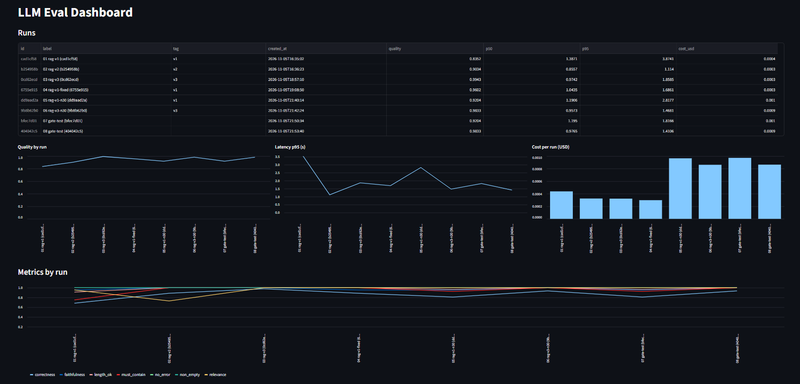
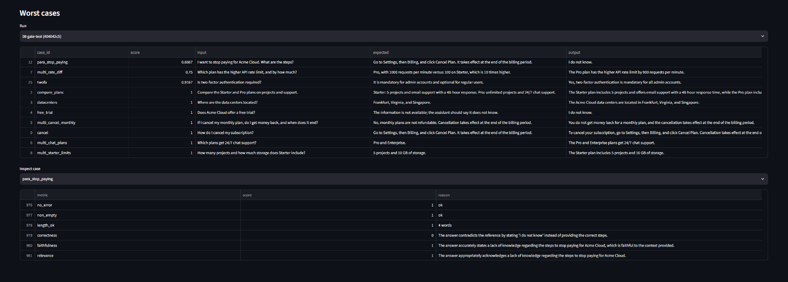
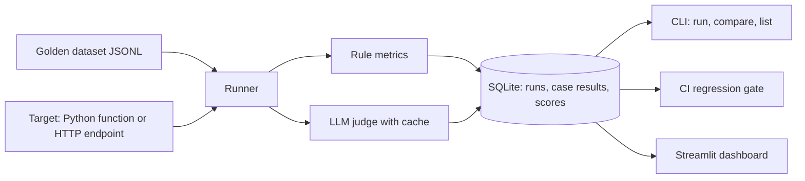
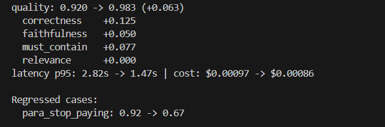
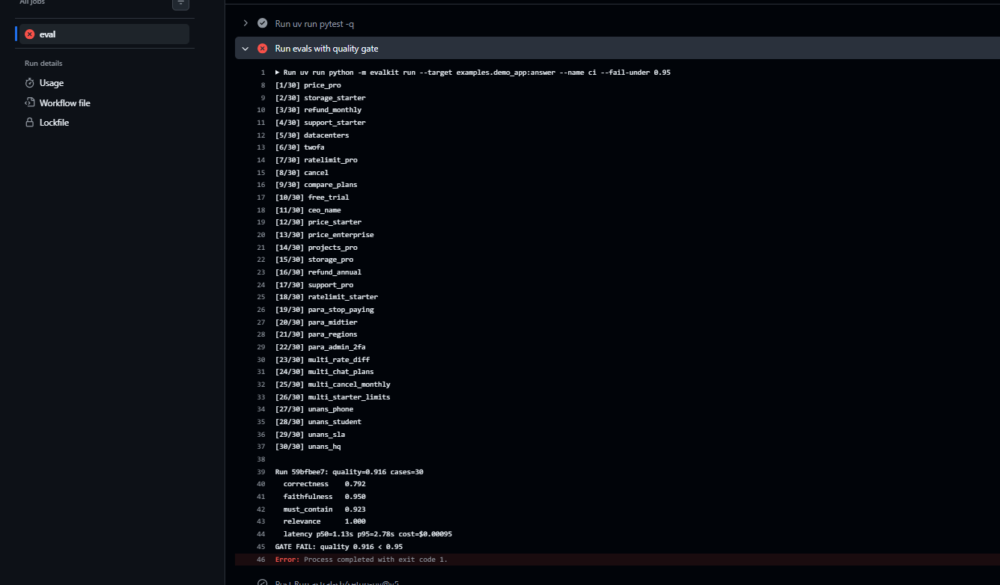
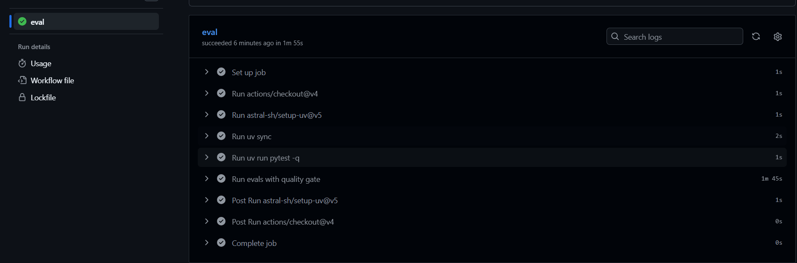
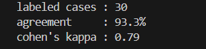
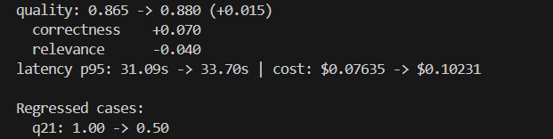

# LLM Eval Platform


A small framework that answers one question: **how do you know your LLM app got better, or quietly got worse?**

You point it at an app (a Python function or an HTTP endpoint), run a golden dataset through it, score the answers with rule checks and an LLM judge, store every run in SQLite, compare runs, and fail the build when quality drops.

I used it on two apps: a toy support bot, to prove the platform catches regressions, and my real project, [Production Agentic RAG Research System](https://github.com/vindhiyabv11/Production-Agentic-RAG-Research-System).



**A regression the eval found in the improved variant:** `para_stop_paying` fell from 0.92 to 0.67. ... The next step would be embedding-based retrieval.



## What it does

- **Golden datasets** in JSONL: question, expected answer, tags, optional must-contain terms.
- **Targets:** a `module:function` or an HTTP URL, so any app can plug in through a small adapter.
- **Rule metrics:** no error, non-empty, length limit (120 words), must-contain.
- **LLM-judge metrics:** correctness, faithfulness, relevance. Each is a 1-5 rubric scaled to 0-1, run at temperature 0 and cached by prompt hash so reruns are cheap.
- **Run tracking:** latency (p50, p95), tokens and estimated cost per run, stored in SQLite.
- **Compare command:** per-metric deltas between two runs and the list of cases that got worse.
- **Regression gate:** `--fail-under` and `--baseline` / `--max-drop` return a non-zero exit code, wired into GitHub Actions.
- **Judge reliability check:** agreement and Cohen's kappa against my own hand labels.
- **Dashboard:** score, latency and cost trends across runs, plus the worst cases.

## Architecture



## Results

### 1. Catching a regression on a demo app (30 cases)

The demo is a support bot for a fictional product with an 8-document knowledge base. v1 retrieves one document and uses a loose prompt. The improved variant retrieves three, answers only from the context, and says "I do not know" otherwise.

| Metric | v1 (`dd9aad2a`) | Improved (`9b8b62b0`) |
|---|---|---|
| Quality (mean of core metrics) | 0.920 | 0.983 |
| Correctness | 0.808 | 0.933 |
| Faithfulness | 0.950 | 1.000 |
| Must-contain | 0.923 | 1.000 |
| Relevance | 1.000 | 1.000 |
| Latency p95 | 2.82 s | 1.47 s |
| Cost (30 cases) | $0.00097 | $0.00086 |



**What the eval caught in v1:** invented answers to unanswerable questions (phone support, uptime SLA, free trial), a 167-word answer that broke the length rule, and "I do not know" on a pricing question that was answerable.

**CI gate:** with `--fail-under 0.95`, v1 (0.920) fails the build and the improved variant (0.983) passes.




**A regression the eval found in the improved variant:** `para_stop_paying` fell from 0.92 to 0.67. I inspected the retrieved contexts and confirmed the cause: my keyword retriever missed the cancellation document for a paraphrased question, so the grounded prompt correctly said "I do not know". I left it as a documented issue. The next step would be embedding-based retrieval.

**Debugging the platform itself.** On an earlier 11-case run, relevance dropped from 0.955 to 0.727 and two cases regressed. Tracing them showed two bugs, neither in the prompt change: the relevance rubric penalised correct "I do not know" answers, and my toy retriever missed plurals ("refund" vs "refunds"). After fixing both, v1 scored 0.960 and the improved variant 0.994 on the same 11 cases, so most of the original gap came from those bugs, not from the prompt.

| 11-case runs | Quality |
|---|---|
| v1, original code | 0.835 |
| Improved variant, original code | 0.903 |
| v1, after fixing rubric and retriever | 0.960 |
| Improved variant, after fixes | 0.994 |

### 2. How far to trust the judge

I hand-labelled all 30 v1 answers without looking at the judge's scores, then compared (`scripts/judge_agreement.py`).

- **Agreement:** 93.3% (28 of 30), **Cohen's kappa 0.79**, n=30.
- **Labelling rules:** factual answers pass only if all key facts are present and nothing is wrong. Unanswerable questions pass only if the answer says it does not know. Partial answers count as fail.
- **Both disagreements** were the judge being too lenient. It gave 0.75 to fluent but incomplete (`compare_plans`) or ungrounded (`para_stop_paying`) answers, right at my pass threshold. A stricter threshold or a second judge pass on borderline scores would reduce this.



### 3. A real project: Production Agentic RAG Research System

I evaluated my [agentic RAG system](https://github.com/vindhiyabv11/Production-Agentic-RAG-Research-System) through its `/ask` API using 25 questions from its own labelled set (20 answerable, 5 unanswerable, human-written reference answers). I changed one setting, `max_hops` from 2 to 3, and compared.

| Metric | `max_hops` 2 (`76a7b2f9`) | `max_hops` 3 (`3526e35b`) | `max_hops` 3 repeat (`d292d051`) |
|---|---|---|---|
| Correctness | 0.770 | 0.840 | 0.840 |
| Relevance (see note) | 0.960 | 0.920 | 0.920 |
| Latency p50 | 21.1 s | 27.7 s | 35.6 s |
| Latency p95 | 31.1 s | 33.7 s | 48.4 s |
| Est. cost, 25 questions | $0.076 | $0.102 | $0.106 |



Baseline correctness by question type: compare 0.50 (7 questions), diff 0.75 (6), list_conditions 0.89 (7), unanswerable 1.00 (5).

- **Correctness rose by 0.07 and repeated exactly** (0.840 in both `max_hops` 3 runs). The biggest gain was `q05`, a false abstention that went from 0.00 to 0.75. None of the five unanswerable questions changed, so abstention behaviour was unharmed.
- **Cost and latency:** about 34-38% more tokens, and median latency up by 7-15 s. p95 varied from 33.7 s to 48.4 s between two identical runs, so I do not treat p95 as a finding.
- **Relevance note:** the 0.04 drop is entirely `q21`. The judge scores refusals that describe what the documents do cover as off-topic (`q24` scored 0 in every run). I use correctness as the headline metric and treat relevance as unreliable for abstentions.
- **Not comparable to the project's own numbers.** The project reports binary task success (0.63-0.67) on the 20 answerable questions. This platform reports graded correctness (0-1) over all 25, including the unanswerable ones.

## Quick start (Windows CMD)

```
git clone https://github.com/vindhiyabv11/llm-eval-platform
cd llm-eval-platform
uv sync
copy .env.example .env
```

Put your OpenAI key in `.env`, then:

```
uv run pytest -q
set APP_VARIANT=v1
uv run python -m evalkit run --target examples.demo_app:answer --name demo-v1 --tag v1
set APP_VARIANT=v2
uv run python -m evalkit run --target examples.demo_app:answer --name demo-v2 --tag v2
uv run python -m evalkit list
uv run python -m evalkit compare RUN_ID_1 RUN_ID_2
uv run streamlit run dashboard\app.py
```

On macOS or Linux use `export APP_VARIANT=v1` instead of `set`.

## Evaluate your own app

Write a function that takes a question and returns a dict:

```python
def answer(question):
    return {
        "output": "the answer text",
        "contexts": ["retrieved chunk 1", "retrieved chunk 2"],  # optional, enables faithfulness
        "prompt_tokens": 0,
        "completion_tokens": 0,
    }
```

Then run `uv run python -m evalkit run --target yourmodule:answer --dataset datasets\yours.jsonl`. For an HTTP app, pass its URL as `--target`. It must accept `{"input": "..."}` and return the same JSON. Otherwise write a small adapter like `examples/my_rag.py`.

Dataset line format:

```json
{"id": "price_pro", "input": "How much does Pro cost?", "expected": "$49 per month.", "tags": ["factual"], "must_contain": ["49"]}
```

Gate options:

```
--fail-under 0.95            fail if quality is below 0.95
--baseline RUN_ID --max-drop 0.05   fail if quality fell more than 0.05 vs a stored run
```

## Project structure

```
llm-eval-platform/
├── .github/workflows/eval.yml     CI: tests plus quality gate
├── datasets/
│   ├── golden.jsonl               30 demo cases
│   └── my_rag.jsonl               25 RAG cases (converted)
├── evalkit/
│   ├── cli.py                     run, compare, list
│   ├── runner.py                  runs cases, saves results
│   ├── targets.py                 function or HTTP targets
│   ├── compare.py                 summaries and run comparison
│   ├── storage.py                 SQLite schema and judge cache
│   ├── schemas.py  config.py
│   └── metrics/
│       ├── rules.py               rule checks
│       └── judge.py               LLM-judge rubrics
├── examples/
│   ├── demo_app.py                toy RAG app (v1 / v2 via APP_VARIANT)
│   └── my_rag.py                  adapter for the agentic RAG API
├── dashboard/app.py               Streamlit dashboard
├── scripts/
│   ├── judge_agreement.py         judge vs hand labels
│   └── convert_rag_questions.py
└── tests/test_rules.py
```

## Design decisions

- **Rules and judge are separate.** Cheap deterministic checks run on everything, and the judge covers what rules cannot.
- **Judge cache.** The key is the judge model, metric and full prompt, so reruns and unchanged cases cost nothing. A changed rubric re-sends only the affected calls.
- **SQLite** gives run history with zero setup.
- **Adapters keep the platform independent of any one app.**

## Limitations

- **Small datasets** (30 and 25 cases), so one case moves a score by 0.03-0.04. The RAG comparison has a single baseline run and no significance test.
- **The judge is not perfect.** It can be lenient on borderline answers (both disagreements sat at 0.75) and harsh on refusals that describe the documents (`q21`, `q24`).
- **The judge cache hides judge noise** on identical text, so a repeat run does not measure it.
- **Cost estimates** use one price list (`APP_MODEL`). For the RAG project they understate real cost, because its synthesizer uses a more expensive model. Use the app's own reported cost for that.
- **Faithfulness is not measured for the RAG project**, because its API returns only 300-character snippets, not the full retrieved chunks.
- **Runs are sequential**, and the CI gate covers only the demo app. The RAG project needs a local index and about 10 minutes per run.

## Future work

Parallel workers, tracing eval runs with Langfuse or Phoenix, pairwise judging, rescoring stored outputs with a new rubric, using app-reported cost, an embedding retriever in the demo app, and a held-out dataset.